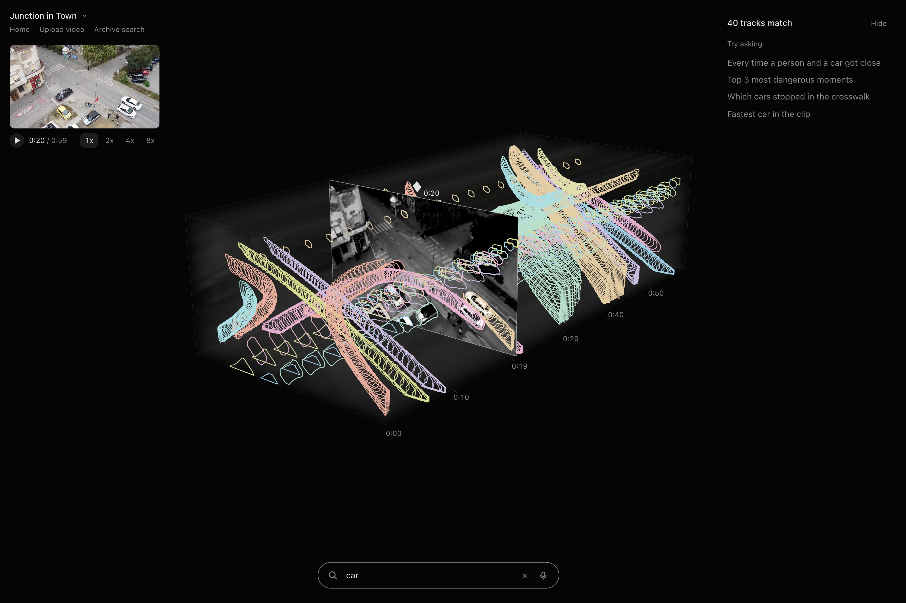
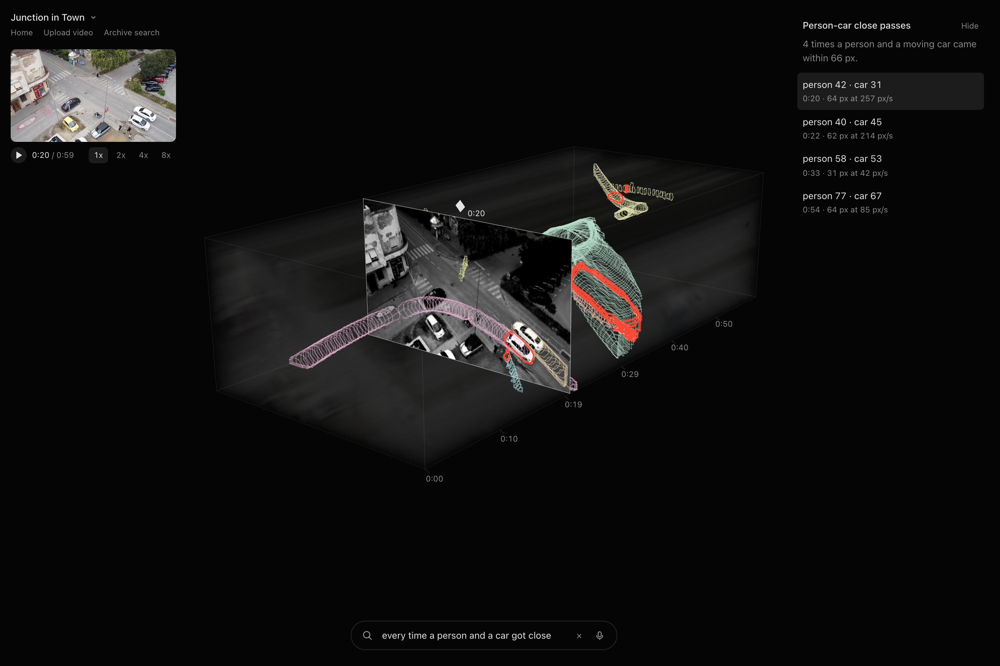
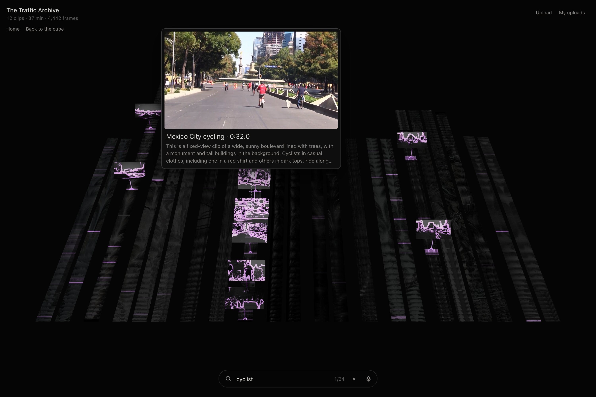
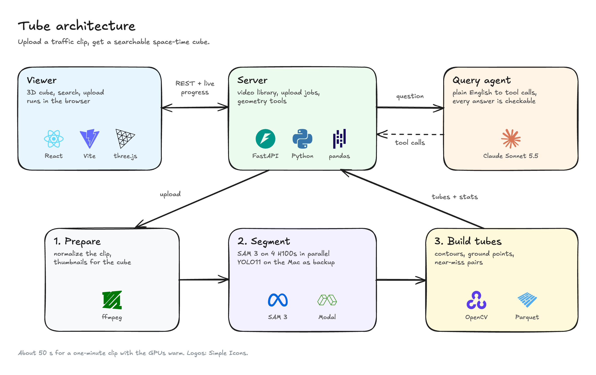

# Tube

**Space-time search for video.** Tube stacks a video into a 3D cube where everything that moves becomes a tube through time. Ask it something in plain English, such as *"every time a person and a car got close"*, and the matching moments light up in the cube, ranked, one click from the video.

Traffic is the first use case: the demo tracks cars, people and bikes from fixed cameras. The same pipeline is aimed at any footage where things move, such as sports and animals.

**Try it:** [tube-kohl.vercel.app](https://tube-kohl.vercel.app). Open the app for a read-only demo, or open **Archive search** to search 12 traffic clips at once.



| Ask a question | Search a whole archive |
| --- | --- |
|  |  |

## What you can do

- **See a clip as a cube.** Drag the frame plane through time, or play the video at 1x to 8x.
- **Search by object.** Type `car` or `person` (or say it, using the mic), and only those tubes appear.
- **Ask questions.** For example "top 3 most dangerous moments" or "which cars stopped in the crosswalk". Claude turns the question into geometry tool calls, so every answer is exact and you can check it frame by frame.
- **Upload your own clip.** Drop in a fixed-camera video of up to 2 minutes. It's ready in about a minute with SAM 3 on Modal, or a few minutes on your own machine.
- **Search the archive.** Search 12 traffic clips by meaning ("a bus turning", "cyclist"). Pin a moment, read its full caption, and send the 40 seconds around it to the cube.

## Quick start

You need **Python 3.11+**, **Node 22** and **ffmpeg**. API keys are optional: without them, Tube runs offline on a bundled synthetic clip.

**1. Get the code**

```sh
git clone https://github.com/amanibobo/tube.git
cd tube
```

**2. Start the server** (terminal 1)

```sh
uv venv && uv pip install -r requirements.txt     # or: python -m venv .venv && .venv/bin/pip install -r requirements.txt
.venv/bin/uvicorn server.main:app --port 8000
```

**3. Start the viewer** (terminal 2)

```sh
cd viewer
npm install
npm run dev
```

**4. Open [localhost:5180](http://localhost:5180)** and click **Open the app**. In the search bar:

- type `car`: only car tubes show;
- click **Every time a person and a car got close**: the close passes glow red. Click one to jump to it.

Without an API key, Tube answers the suggested questions from its cache. To ask anything else, add a key (below).

## Optional setup

### Ask any question (Claude)

```sh
export ANTHROPIC_API_KEY=sk-ant-...
.venv/bin/uvicorn server.main:app --port 8000
```

Set `TUBEWATCH_OFFLINE=1` to force cache-only answers, even with a key.

### Fast segmentation (SAM 3 on Modal)

By default, uploads are segmented on your machine with YOLO11 and ByteTrack, at about 4 minutes per minute of video. SAM 3 on [Modal](https://modal.com) GPUs is faster, about a minute per clip, and gives tighter outlines.

1. Accept the license at [huggingface.co/facebook/sam3](https://huggingface.co/facebook/sam3) and create a read token.
2. Run:

   ```sh
   .venv/bin/modal token new                                         # once, logs you in
   .venv/bin/modal secret create huggingface HF_TOKEN=hf_...
   .venv/bin/modal deploy -m pipeline.sam3_modal
   ```

3. Restart the server. Uploads now use SAM 3 automatically, and fall back to YOLO if Modal is unreachable.

### Archive search

The archive page (`/archive`) talks to a deployed [vidsearch](https://github.com/amanibobo/vidsearch) backend, which does SigLIP 2 and caption search over clips stored on Cloudflare R2. It uses the public one by default. To point it at your own, build the viewer with `VITE_ARCHIVE_API=https://<your-workspace>--vidsearch-traffic-web.modal.run`.

## Add the real demo clip

The repo ships only a synthetic clip. To rebuild the junction clip from the live demo, a 60-second drone shot from Pexels:

```sh
mkdir -p data/raw/pexels-13905521 && cd data/raw/pexels-13905521
curl -L -o 13905521.mp4 https://www.pexels.com/download/video/13905521/
ffmpeg -ss 24 -i 13905521.mp4 -t 60 -an -vf scale=1280:-2 -c:v libx264 -crf 20 junction-24s-84s.mp4
cd ../../..
.venv/bin/python -m pipeline.ingest data/raw/pexels-13905521/junction-24s-84s.mp4 --out data/pexels-junction
echo '[{"id":"crosswalk","name":"crosswalk","polygon":[[300,345],[430,335],[565,470],[395,490]]}]' \
  > data/pexels-junction/zones.json        # the crosswalk the crosswalk questions use
```

Restart the server, and the clip appears in the video switcher. Any clip of your own works the same way: `python -m pipeline.ingest <video> --out data/<name> [--backend auto|sam3|yolo]`. Or just upload it in the app.

## How it works



1. **Prepare.** ffmpeg normalizes the clip (at most 1280x720 and 120 s) and cuts thumbnails. The cube and frame plane appear within seconds, before any tracking is done.
2. **Segment.** SAM 3 finds vehicles, people and bicycles with text prompts. It splits the clip into chunks that run on several GPUs at once, and stitches the tracks back together where the chunks overlap. YOLO11 is the local fallback.
3. **Build tubes.** OpenCV turns each mask into a contour per frame. pandas and shapely compute speeds, ground contact points (feet and wheels, not centers) and close passes, and skip people hidden behind vehicles.
4. **Ask.** Claude Sonnet 5.5 plans calls to geometry tools (`near`, `stopped`, `in_zone`, `rank_near_misses`, `count`). The tools do the math; Claude only picks which to call and phrases the answer.

The API contract is [docs/api.md](docs/api.md). The decisions behind the design are in [docs/decisions.md](docs/decisions.md), and the original plan is [docs/PRD.md](docs/PRD.md).

## Project layout

| Path | What's there |
| --- | --- |
| `viewer/` | The web app (Vite, React, three.js, react-three-fiber): landing page `/`, cube `/app`, archive `/archive` |
| `server/` | FastAPI: the video library, upload and clip jobs, geometry tools, the Claude agent |
| `pipeline/` | ffmpeg, SAM 3 on Modal, YOLO, contour building, stats |
| `data/` | One folder per video (`tubes.json`, `stats.parquet`, frames). Only `synthetic/` is committed |
| `tests/` | pytest for tools, uploads, clips, chunk stitching and geometry |
| `docs/` | PRD, decisions, API contract, data sources, architecture diagram (`.excalidraw` + PNG) |

## Development

```sh
.venv/bin/ruff check . && .venv/bin/python -m pytest -q        # server and pipeline
cd viewer && npm run typecheck && npm run lint && npm run build   # viewer
npm run walkthrough                                               # drives the app in a real browser (servers must be running)
node scripts/archive.mjs                                          # same for the archive page
```

`npm run dev:fixture` runs the viewer on [localhost:5181](http://localhost:5181) against a built-in fake server, with no Python needed.

### Deploying the hosted demo

The hosted site is a static build, and it needs no server. A script snapshots one video from your running server: its tubes, frames and saved answers.

```sh
cd viewer
node scripts/export-static.mjs pexels-junction    # writes public/demo/ (git-ignored)
VITE_STATIC=1 npx vite build --outDir ../dist-tube
cd ../dist-tube && npx vercel deploy --prod
```

In the static build, uploads, new questions and "Open in the cube" say they need Tube running locally. Everything else works.

## Settings

| Variable | Where | Default | What it does |
| --- | --- | --- | --- |
| `ANTHROPIC_API_KEY` | server | none | Live answers to any question |
| `TUBEWATCH_OFFLINE` | server | off | `1` serves cached answers only |
| `TUBEWATCH_DATA_ROOT` | server | `data/` | Where videos live |
| `TUBEWATCH_BACKEND` | server | `auto` | `sam3`, `yolo` or `auto` (SAM 3 when Modal is reachable) |
| `VITE_API_TARGET` | viewer dev | `http://localhost:8000` | Where the dev server proxies `/api` |
| `VITE_ARCHIVE_API` | viewer build | the public vidsearch API | Backend for `/archive` |
| `VITE_STATIC` | viewer build | off | `1` builds the server-less demo |

## Credits

Built by [Amani Bobo](https://www.linkedin.com/in/amanibobo) for [Hacklanta '26](https://hacklanta.dev).

- Demo clip: "Junction in Town" by Lazar Gugleta on Pexels. Other clip sources and licenses are in [docs/data-sources.md](docs/data-sources.md).
- Diagram logos: [Simple Icons](https://simpleicons.org).
